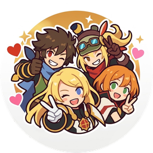
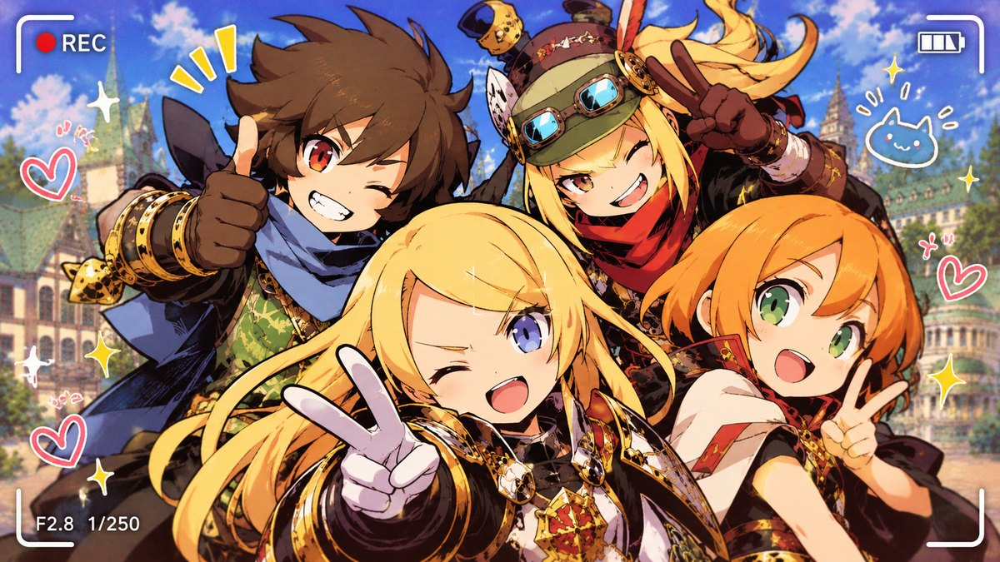

<div align="center">



# EO HD – Trocador de Retratos

### Seu *Etrian Odyssey* do **seu** jeito. 🎨⚔️

**Troque personagens, NPCs e inimigos do Etrian Odyssey HD pelas suas próprias artes — em poucos cliques, sem editar código e com backup automático.**

[](https://github.com/yurammaruy/eo_hd-trocador-de-retratos/releases/latest)
[](https://github.com/yurammaruy/eo_hd-trocador-de-retratos/issues/new/choose)




</div>

---

## 🌟 Por que você vai gostar

Já pensou em ver **a sua guilda** de verdade dentro do jogo? A sua fanart como retrato da Sovereign, o seu OC no lugar do Ronin, um visual novo para aquele inimigo que você enfrenta há 100 horas?

O **EO HD – Trocador de Retratos** faz isso por você. Sem planilhas, sem linha de comando, sem ferramentas de extração: é só **escolher, editar e aplicar**.

> 🧑‍🎨 Pensado para **artistas e jogadores comuns** — se você sabe usar o Paint, o Photoshop ou o Krita, já sabe o suficiente.

## 🚀 O que ele faz

| | |
|---|---|
| 🖼️ **Editar conjunto de imagem** | Veja as **4 imagens do personagem** (corpo inteiro, criação, resultado e batalha) *do jeito que aparecem no jogo*, com recorte automático. |
| 📋 **Fila de alterações** | Monte tudo com calma e envie de uma vez com **APLICAR TODAS AS ALTERAÇÕES**. |
| 💾 **Backup automático** | Cada jogo tem o seu backup. Errou? **Restaurar este original** ou **Restaurar TODOS**. |
| 📚 **Álbuns `.eoalbum`** | Guarde seu pacote de imagens e compartilhe com a comunidade. |
| 🧠 **Memória por jogo** | Lembra a pasta do EO1, do EO2 e do EO3 — é só trocar no menu. |
| 🌍 **10 idiomas** | Português, English, Français, Italiano, Deutsch, Español, 日本語, 简体中文, 繁體中文 e 한국어. |
| 🎓 **Tutorial dentro do programa** | Botão *Tutorial* com o passo a passo completo, no seu idioma. |

## 🎮 Jogos suportados

| Jogo | Situação |
|------|----------|
| **Etrian Odyssey HD (EO1)** | ✅ Funcionando |
| **Etrian Odyssey II HD (EO2)** | ✅ Funcionando |
| **Etrian Odyssey III HD (EO3)** | ✅ Funcionando |

## 📥 Instalação em 3 passos

1. Entre em **[Releases](https://github.com/yurammaruy/eo_hd-trocador-de-retratos/releases/latest)** e baixe o **`INSTALAR_EO_RETRATOS.bat`**.
2. Dê dois cliques. Ele faz **tudo sozinho**: instala o Python (só para o seu usuário, se faltar), as bibliotecas e cria o **atalho na Área de Trabalho**. Pasta padrão: `C:\EO Retratos` (você pode escolher outra).
3. Abra o atalho **EO HD – Trocador de Retratos** e divirta-se!

> ⚠️ O Windows pode avisar *"o Windows protegeu o computador"* porque o arquivo não tem assinatura digital paga. Clique em **Mais informações → Executar assim mesmo**. O instalador é um arquivo de texto: você pode abri-lo no Bloco de Notas e conferir tudo, e o código-fonte está aqui neste repositório.

<details>
<summary><b>Instalação manual (para quem já tem Python)</b></summary>

```bash
# Python 3.10 a 3.13
pip install UnityPy Pillow
python eo_retratos.py
```

</details>

## 🕹️ Como usar (em 4 passos)

1. **Feche o jogo.** Abra o programa, escolha **EO1, EO2 ou EO3** e clique em **Escanear**.
2. Clique numa imagem e em **EDITAR ESSE CONJUNTO DE IMAGEM** *(ou use Exportar → editar no seu programa de arte → Importar, mantendo o **mesmo tamanho**)*.
3. Clique em **APLICAR TODAS AS ALTERAÇÕES**.
4. Abra o jogo e veja a sua arte lá dentro. ✨

Quer o passo a passo completo? Ele está no botão **Tutorial** do programa.

## ❓ Perguntas frequentes

**A imagem ficou branca no jogo.**
Use *Avançado → Catálogo: DESATIVAR CRC* (o programa faz backup do catálogo antes).

**Posso estragar o meu jogo?**
O programa guarda os originais antes de qualquer mudança, e os botões de restaurar devolvem tudo. Mesmo assim, o uso é **por sua conta e risco**; se quiser, faça também uma cópia da pasta do jogo.

**Funciona com outros mods?**
Teste primeiro com os outros mods **desativados**. Mods que mexem nos mesmos arquivos podem conflitar.

**Precisa de internet?**
Só para instalar. Depois funciona offline.

**Isso me dá algum risco de ban?**
Os jogos são para um jogador, offline. Ainda assim, o programa altera arquivos do jogo no *seu* computador — use sempre com responsabilidade.

## 🐞 Achou um erro? Tem uma ideia?

Abra um **[Issue](https://github.com/yurammaruy/eo_hd-trocador-de-retratos/issues/new/choose)** — há um formulário pronto para **Reportar erro** e outro para **Sugestão / feedback**. Se puder, anexe os arquivos **`erro_log.txt`** e **`diagnostico.txt`** (pasta do programa). Cada relato melhora o programa para todo mundo. 💙

## ⚖️ Aviso legal

Projeto **de fã, gratuito e sem fins lucrativos**, sem qualquer ligação com a ATLUS, a SEGA ou a Valve. *Etrian Odyssey* e seus personagens pertencem aos seus donos. O programa **não contém nem distribui arquivos do jogo**: ele só altera, no seu computador, a cópia que **você** comprou.

## 📄 Licença

Livre para **usar, copiar e compartilhar sem alterações**. Alterar o código exige autorização do autor. Veja o [LICENSE](LICENSE).

## 🙏 Créditos

Feito com [UnityPy](https://github.com/K0lb3/UnityPy), [Pillow](https://python-pillow.org/) e Tkinter. Obrigado a toda a comunidade de Etrian Odyssey! ⭐ **Se o projeto te ajudou, deixe uma estrela no repositório!**
